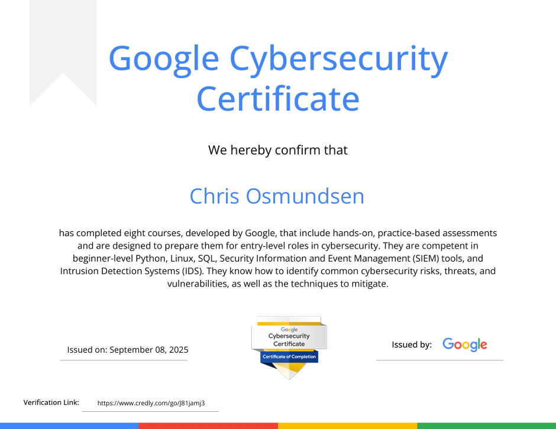

# Google Cybersecurity Certificate

**Status:** Fullført, 8. september 2025
**Utsteder:** Google
**Credential:** [Verifiser hos Credly](https://www.credly.com/badges/fa5fe147-abf2-417c-8a59-bae846da52a3/linked_in_profile)

## Hva sertifiseringen dekker

Programmet består av åtte kurs utviklet av Google, med praktiske vurderinger. Det er laget for å forberede på nybegynnerroller innen cybersecurity, og dekker blant annet:

- Python på nybegynnernivå
- Linux
- SQL
- SIEM-verktøy (Security Information and Event Management)
- Intrusion Detection Systems (IDS)
- Å identifisere vanlige risikoer, trusler og sårbarheter, og teknikker for å redusere dem

## Hva jeg tok med meg

Skriv 3–5 setninger med egne ord her. For eksempel: hva du lærte som du har brukt senere (Linux, SQL, SIEM?), og hvordan det henger sammen med SC-900 og CCNA.
