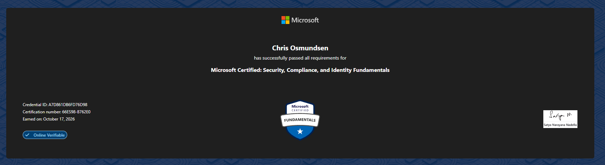

# SC-900: Microsoft Security, Compliance, and Identity Fundamentals

**Status:** Passed, October 2026
**Credential:** [Verify on Microsoft Learn / Credly](ADD-LINK-HERE)

## What the exam covers

| Domain | Weight |
|---|---|
| Security, compliance and identity concepts | 10–15 % |
| Microsoft Entra (identity and access) | 25–30 % |
| Microsoft security solutions | 35–40 % |
| Microsoft compliance solutions | 20–25 % |

## How I studied

- Microsoft Learn
- Wrote my own notes per domain, then merged them into one study document
- Practice questions and self-tests on the confusing pairs (alert vs. incident, SIEM vs. XDR, DLP vs. Insider Risk)

## Notes

[`SC-900_Supernotat.pdf`](./SC-900_Supernotat.pdf) is my combined study document (in Norwegian). It includes a scenario-to-answer cheat sheet, a list of commonly confused concepts and a self-test.

## What I took away

Write 3–5 sentences in your own words here. For example: which topic you found most useful (Zero Trust, Conditional Access, Sentinel?) and what you want to try hands-on next.
